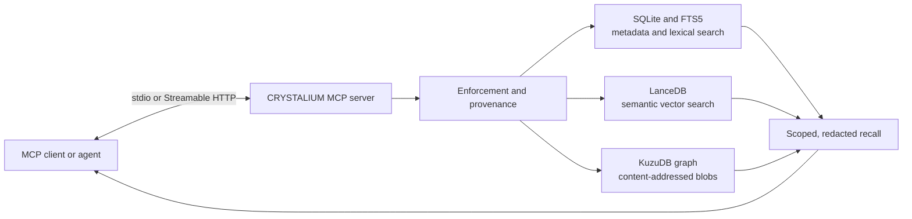

<div align="center">
  <br />
  <h1>CRYSTALIUM</h1>
  <strong>Persistent memory for MCP agents, with provenance and trust at the center.</strong><br />
  Keep useful project context between sessions. Let the agent decide what it means.
</div>

<p align="center">
  <a href="https://github.com/Rynaro/crystalium/actions/workflows/ci.yml"></a>
  <a href="LICENSE"></a>
  <a href="https://modelcontextprotocol.io/"></a>
  <a href="https://github.com/Rynaro/crystalium/releases/latest"></a>
</p>

> **CRYSTALIUM is a local memory service, not an agent.** It stores, protects, finds, and consolidates information. Your MCP client or agent remains responsible for reasoning and action.

## Start here

- [Connect an MCP client](#connect-an-mcp-client)
- [Understand the four memory layers](#four-layers-one-memory-system)
- [Try a read-only request](#try-a-read-only-request)
- [Explore the MCP tools](#mcp-surface)
- [Configure memory behavior](#memory-injection-is-deliberate)
- [Contribute](#contributing)

## Why CRYSTALIUM?

Agents often start a new session without the decisions, fixes, and working patterns that made the last one useful. CRYSTALIUM gives MCP clients a shared, persistent place to keep that context, with records scoped by project and guarded as they move between trust levels.

It connects through the **Model Context Protocol (MCP)**, an open protocol for applications to expose tools and context to AI clients. CRYSTALIUM is an MCP server: your client discovers its tools and calls them over stdio or Streamable HTTP.

The service does not train a model or inject every stored memory into every prompt. An agent asks for relevant context; CRYSTALIUM applies scope, access, redaction, and retrieval rules, then returns bounded results. The agent decides what to do with them.

**Use it when** an agent should carry useful context between sessions, preserve the source of a handoff, or retrieve a previously verified fix. It can run as a standalone MCP server; Eidolons roster membership is not required.

## Connect an MCP client

### Requirements

- Git
- Docker with Docker Compose v2
- An MCP client that supports stdio servers

1. Clone the repository and build the image:

```bash
git clone https://github.com/Rynaro/crystalium.git
cd crystalium
docker compose build
```

The first use of embeddings downloads the `bge-m3` model. Allow network access for that initial model download.

2. Add this server entry to your MCP client's configuration. It uses the common `mcpServers` wrapper; clients may use a different wrapper or configuration file location, so adapt the surrounding format to your client. Replace both occurrences of `/absolute/path/crystalium` with the full path to your checkout.

```json
{
  "mcpServers": {
    "crystalium": {
      "command": "docker",
      "args": [
        "compose", "-f", "/absolute/path/crystalium/docker-compose.yml",
        "--project-directory", "/absolute/path/crystalium",
        "run", "--rm", "-T", "crystalium",
        "python", "-m", "crystalium", "serve"
      ]
    }
  }
}
```

3. Restart or reload the MCP client, then discover the `crystalium` tools. A successful connection exposes 10 tools. The server uses stdio: Docker keeps its standard input connected, and `-T` disables a pseudo-terminal so JSON-RPC traffic stays clean. The Compose named volume `crystalium_data_v2` stores runtime data under `/data`; the default project store is `/data/default` inside the container.

### Try a read-only request

Call `assemble_context` with a project scope and a question:

```json
{
  "scope": {"project": "default"},
  "query": "What fixed the failing test?",
  "k": 3,
  "needs_memory": true,
  "layers": ["semantic", "episodic", "procedural"]
}
```

A new store has no memories, so an empty result is expected. To receive context, the client must first commit or ingest records through the available write tools and tier checks. The server's `CRYSTALIUM_DATA_DIR` selects the store directory; `scope.project` must match its canonical basename. A scope value alone does not create or provision a directory.

### Use a separate project store

To use another store, add the environment option to the MCP server command **before** the Compose service name, then use its basename as `scope.project`:

```json
"args": [
  "compose", "-f", "/absolute/path/crystalium/docker-compose.yml",
  "--project-directory", "/absolute/path/crystalium",
  "run", "--rm", "-T", "-e", "CRYSTALIUM_DATA_DIR=/data/my-project",
  "crystalium", "python", "-m", "crystalium", "serve"
]
```

Send `"scope":{"project":"my-project"}` in tool requests. The process configuration selects the directory; the matching scope key labels the project for access and retrieval. Separate projects use separate stores within the named volume.

## Four layers, one memory system

| Layer | In plain language | Typical contents |
|---|---|---|
| **Episodic** | What happened | Session outcomes, source-backed events, and newly received records; untrusted input can remain quarantined. |
| **Semantic** | What appears to be true | Curated facts and stable project conventions, promoted through review gates. |
| **Procedural** | How to do a task | Reusable skills or recipes admitted through verification. |
| **Execution** | What is in progress | Short-lived checkpoints and replanning state with a time-to-live. |

Records retain provenance and trust information. When multiple records contribute to a derived memory, the lowest trust level propagates; consolidation cannot silently upgrade untrusted input. The Dream worker performs background consolidation and pruning between MCP requests; it proposes changes through the same gates rather than bypassing them.



The server owns persistence and policy; the client owns the reasoning loop. Local embedded stores are the default. Optional integrations and transport choices are configuration-dependent; see [the design rationale](DESIGN-RATIONALE.md) before making deployment or privacy assumptions.

The working-set composer limits selected context to **3,500 tokens total** across its slots. This is a separate budget from `assemble_context`'s requested record cap (`k`, recommended at 3 or fewer); retrieved records can be omitted when the composer budget is full.

## MCP surface

The server exposes **10 tools** and is currently **tools-only**. MCP resources, prompts, structured output, and elicitation are not shipped. Serialized JSON in text content is not MCP structured output.

| Tool | What it does |
|---|---|
| `assemble_context(scope, query, k, needs_memory, prior_failure, layers)` | Returns bounded task context when the configured memory gate opens. |
| `recall(scope, query, k, layers, explain)` | Searches explicitly across lexical, vector, and graph signals. |
| `commit(layer, payload, provenance)` | Writes a record through tier and path enforcement. |
| `ingest(envelope, payload)` | Imports an ECL handoff while preserving its source and trust. |
| `update(id, patch, reason)` | Revises a record with an auditable reason. |
| `skill_invoke(name, args)` | Runs the verifier for procedural skill admission. |
| `plan_checkpoint(state)` | Saves short-lived execution state. |
| `plan_replan(diff)` | Records a change to execution state. |
| `session_end(reason)` | Signals the end of a session and queues consolidation work. |
| `graph_export(scope, format, layers, limit, include)` | Exports a scoped, redacted graph view. |

---

Successful tool calls write ECL v2.0 envelope sidecars with SHA-256 integrity metadata to the local run directory. See the [EIIS installation contract](SPEC.md) and [ECL envelope notes](CRYSTALIUM.md) for protocol details.

## Memory injection is deliberate

For task context, recall only when there is an explicit need, a prior failure, or ambiguity that relevant prior records could resolve. In `assemble_context`, express ambiguity with `needs_memory=true`; there is no separate ambiguity flag or hidden classifier. The defaults for `needs_memory` and `prior_failure` are both `false`.

Request `k<=3` and prefer relevant verified fix-span records over broad session narratives. This guidance is **provisional pending representative coding evaluation**. The planted fixture report is synthetic calibration, not evidence of a live-solver benefit or a reason to change defaults.

Use `recall` when explicitly searching memory; its API default remains `k=10`. That default does not recommend unconditional prompt injection. Typed fix-span records and optional ingest proposals are documented in [structured repair records](docs/fix-spans.md); both feature flags default off.

See [memory injection: configuration and evaluation](docs/memory-injection.md), the [coding A/B harness](evals/coding_ab/README.md), and its [fixture report](evals/coding_ab/results/fixture/report.md) for the behavior and limits of current evidence.

## Trust and deployment

Each write passes through a shared enforcement chokepoint for tier, path, and rate checks. The trust tiers distinguish who or what supplied a record:

| Tier | Source | Treatment |
|---|---|---|
| **T0** | Operator | May perform operator-only actions such as audited forgetting. |
| **T1** | Trusted agent | Writes under the configured layer and operation rules. |
| **T2** | Lower-trust agent | May write Episodic records and Procedural candidates; cannot write Semantic or Execution records or promote candidates. |
| **T3** | Tool-origin or otherwise untrusted input | Constrained and quarantined by default; cannot gain trust through consolidation. |

Ordinary `update` operations preserve history through bitemporal tracking and never hard-delete records. Forgetting is a distinct, audited operator action. See [the specification](SPEC.md) for the full tier matrix and [the design rationale](DESIGN-RATIONALE.md) for the policy decisions.

The default stdio server uses local embedded storage. Streamable HTTP is available for clients that need it, but the application does **not** provide authentication or TLS. Caller identity comes from server process configuration, not authenticated HTTP client credentials. Keep the service on loopback unless it is behind an authenticated TLS proxy.

To run Streamable HTTP in Docker, publish only the local loopback port:

```bash
docker compose run --rm -p 127.0.0.1:8848:8848 \
  -e CRYSTALIUM_TRANSPORT=http \
  -e CRYSTALIUM_HTTP_HOST=0.0.0.0 \
  crystalium python -m crystalium serve
```

Connect to `http://127.0.0.1:8848/mcp/`. The trailing slash avoids a redirect. The container binds to `0.0.0.0` internally while Docker exposes the service only on host loopback. See [CRYSTALIUM.md](CRYSTALIUM.md) for HTTP configuration details.

<!-- eiis-v3-package:start -->
## Install as an EIIS package

The repository includes an EIIS package installer for compatible agents. See [INSTALL.md](INSTALL.md) for the package contents and install steps. The standalone MCP server above does not depend on this installer.
<!-- eiis-v3-package:end -->

## Choose your path

| If you are… | Start with… |
|---|---|
| **New to agent memory** | [The four layers](#four-layers-one-memory-system), then [your first request](#try-a-read-only-request). |
| **Integrating a client** | [MCP tools](#mcp-surface), [memory injection behavior](docs/memory-injection.md), then [operator configuration](CRYSTALIUM.md). |
| **Evaluating memory behavior** | [Coding A/B harness](evals/coding_ab/README.md), [wire evaluation](evals/wire/README.md), and [benchmark notes](evals/BENCH-NOTES.md) for evidence scope and limitations. |
| **Contributing** | [Development standards](AGENTS.md), then [the roadmap](ROADMAP-POST-1.0.md). |

For system-level details, read the [authoritative specification](SPEC.md), [architecture and research notes](CRYSTALIUM.md), [design decisions](DESIGN-RATIONALE.md), and [release history](CHANGELOG.md). Typed repair records are described in [docs/fix-spans.md](docs/fix-spans.md).

## Troubleshooting

**The client does not show CRYSTALIUM tools.** Confirm Docker is available, the image built successfully, the client configuration points to the absolute repository path, and the client was restarted after editing its configuration. Inspect the MCP client's server logs for startup errors.

**The first request takes a while.** The embedding model is downloaded on first embedding use. Allow that download to finish before retrying.

**A query returns no records.** An empty store returns an empty result. Check that the writer used the same `scope.project` as the reader and that the relevant memory passed its write and trust gates.

**`ModuleNotFoundError: No module named 'crystalium'`.** Run the server with the Compose project directory set to the repository root as shown above.

## Contributing

Issues and pull requests are welcome. For a local development setup, build the container and use the repository's host wrappers:

```bash
docker compose build
make test
make lint
make test-schemas
```

`make test-fast` is available for a quicker suite that skips model-download tests. Alternatively, use `docker compose run --rm crystalium pytest mcp-server/tests/ -v` for the full test suite. Do not invoke Python, pip, uv, pytest, or Node directly on the host. See [AGENTS.md](AGENTS.md) for development standards and [the roadmap](ROADMAP-POST-1.0.md) for tracked follow-up work.

## License

CRYSTALIUM is licensed under the [Apache License 2.0](LICENSE).

<!-- Provenance: IDG Scribe 1.10.0; document type: README; generated 2026-10-19.
Sources: provided ATLAS fact ledger; prior README; docs/memory-injection.md;
.eidolons/idg/PERSONA.md; .eidolons/idg/SPEC.md. Gate: complete, useful, source-grounded. -->
